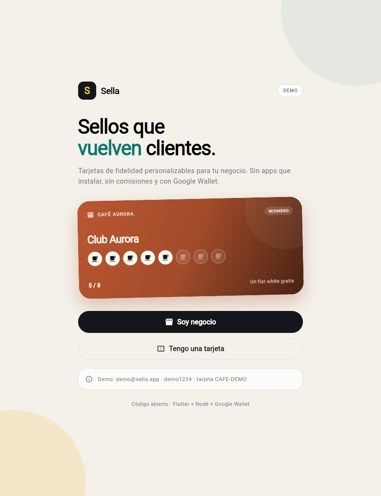
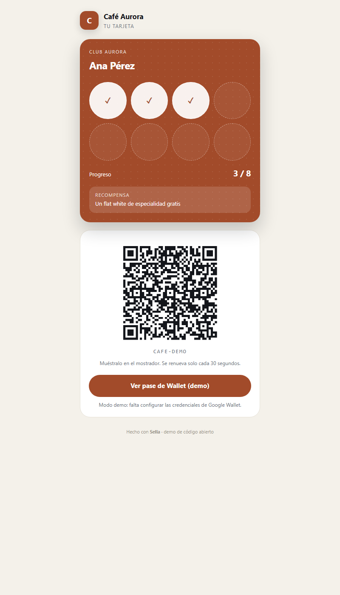
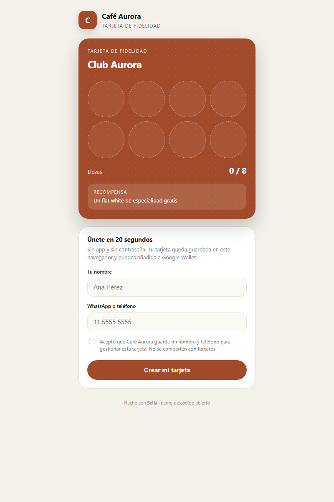
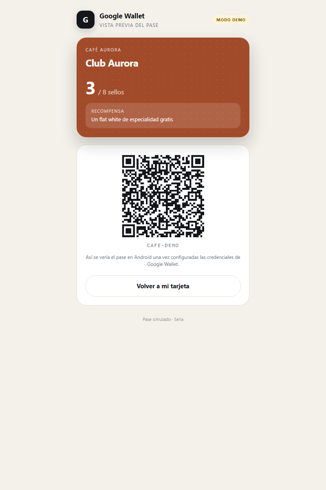
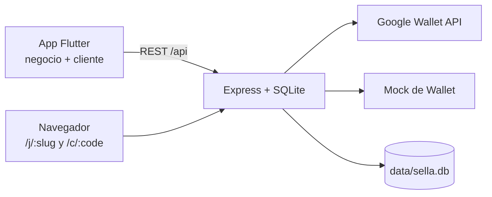

# Sella

**Tarjetas de fidelidad para negocios, personalizables y sin comisiones.**

Sella es una aplicación completa —app Flutter, API Node y base SQLite— para que un negocio cree su
programa de sellos, personalice la tarjeta, sume puntos escaneando un QR y entregue recompensas.
El cliente no instala nada: usa la web o añade la tarjeta a Google Wallet.

<p>
  
  
  
  
</p>



---

## El problema

Los programas de fidelidad con tarjeta de cartón se pierden, no se miden y no se pueden personalizar.
Las plataformas grandes cobran comisión por canje y no dejan cambiar ni el color de la tarjeta.

Sella resuelve tres cosas concretas:

1. **El negocio diseña** su tarjeta (colores, logo, ícono de sello, meta, recompensa) sin depender de nadie.
2. **El cliente la lleva en el teléfono**, con QR que rota cada 30 segundos y respaldo web si no tiene la app.
3. **Los sellos no se pueden falsificar**: se validan contra el servidor, con firma HMAC y un solo uso por QR.

## Demo

| Rol | Credenciales |
| --- | --- |
| Negocio | `demo@sella.app` / `demo1234` |
| Negocio 2 | `barber@sella.app` / `demo1234` |
| Cliente | código `CAFE-DEMO` (3 de 8 sellos) |
| Cliente con premio | código `CAFE-8F3K` (8 de 8) |

Demo pública: _pendiente de desplegar_ — los pasos están en [docs/05-despliegue.md](docs/05-despliegue.md).

Páginas que podés abrir sin instalar nada:

- `/j/cafe-aurora` — inscripción de un cliente
- `/c/CAFE-DEMO` — tarjeta con QR y botón de Wallet
- `/wallet/mock/CAFE-DEMO` — cómo se verá el pase de Google

## Capturas

| Tarjeta del cliente (web) | Inscripción sin app |
| --- | --- |
|  |  |

| Pase de Google Wallet (modo demo) | Landing de la app |
| --- | --- |
|  |  |

## Funcionalidades

**Para el negocio**

- Registro en 2 minutos con programa y tarjeta por defecto.
- Editor visual con vista previa en vivo: 4 plantillas, 8 paletas, 7 íconos de sello, 4 texturas.
- Meta configurable (2 a 20 sellos) y cooldown entre sellos (15 min a 1 día).
- Escaneo de QR con la cámara o búsqueda manual por código/teléfono.
- Alta manual de clientes desde el mostrador.
- Métricas del día: sellos, clientes, recompensas listas y canjeadas.
- Link de inscripción único por negocio.

**Para el cliente**

- Se une desde el navegador, sin instalar ni crear contraseña.
- Tarjeta con progreso, recompensa y QR que se renueva solo.
- Botón "Añadir a Google Wallet" (real o mock).
- La misma tarjeta funciona en la app Flutter si prefiere instalarla.

**Seguridad**

- QR firmado con HMAC-SHA256 por tarjeta, expiración de 60 s y nonce aleatorio.
- Registro de tokens usados: una captura de pantalla no sirve dos veces.
- Canje idempotente: doble tap no suma doble sello.
- Aislamiento multi-negocio: un negocio no puede sellar tarjetas de otro.
- Datos mínimos: nombre, teléfono y consentimiento explícito.

## Arquitectura



Un solo servicio en producción: Express sirve la API, las páginas HTML y el build de Flutter Web.
Eso elimina CORS, simplifica el despliegue y da HTTPS gratis para la cámara.

Más detalle en [docs/01-arquitectura.md](docs/01-arquitectura.md).

## Cómo correrlo

Requisitos: **Node 20+** y **Flutter 3.27+**.

### 1. Backend

```bash
cd backend
npm install
cp .env.example .env     # en Windows: copy .env.example .env
npm start
```

La primera vez crea la base y carga los datos demo. Queda en `http://localhost:3000`.
Ya podés probar `/j/cafe-aurora` y `/c/CAFE-DEMO`.

### 2. App Flutter

```bash
cd app
flutter pub get
flutter run -d chrome      # o -d <tu dispositivo>
```

La app apunta a `http://localhost:3000` por defecto. Para otro host:

```bash
flutter run --dart-define=API_URL=http://192.168.1.50:3000
```

En Android emulado usa `10.0.2.2` automáticamente.

### 3. Todo en un solo puerto (como en producción)

```bash
./scripts/build-web.sh          # Windows: .\scripts\build-web.ps1
cd backend && npm start
```

Ahora `http://localhost:3000` sirve la app completa.

### Docker

```bash
docker compose up --build
```

El `Dockerfile` compila Flutter Web y lo empaqueta con Node. La primera build tarda varios minutos.

## Configuración

| Variable | Obligatoria | Descripción |
| --- | --- | --- |
| `PORT` | No | Puerto del servidor (3000). |
| `APP_URL` | En producción | URL pública sin barra final. Se usa en links y en Wallet. |
| `JWT_SECRET` | Sí en producción | Firma de sesiones. |
| `QR_PEPPER` | Sí en producción | Secreto extra para firmar los QR. |
| `DB_PATH` | No | Ruta del archivo SQLite. Default `backend/data/sella.db`. |
| `AUTO_SEED` | No | `false` desactiva los datos demo. |
| `GOOGLE_WALLET_ISSUER_ID` | No | Activa el pase real de Google. |
| `GOOGLE_WALLET_CLIENT_EMAIL` | No | Email de la cuenta de servicio. |
| `GOOGLE_WALLET_PRIVATE_KEY` | No | Clave privada (con `\n` escapados). |
| `GOOGLE_WALLET_CLASS_SUFFIX` | No | Sufijo de la clase (`sella_loyalty_v1`). |

Sin credenciales de Google, el botón de Wallet abre un **pase simulado** claramente marcado como demo.
El resto del producto funciona igual.

## Google Wallet

Google exige tres cosas antes de emitir pases a clientes reales:

1. Cuenta de emisor en [Google Pay & Wallet Console](https://pay.google.com/business/console/).
2. Proyecto de Google Cloud con la **Google Wallet API** habilitada y una cuenta de servicio.
3. Solicitar **acceso de publicación**: las cuentas nuevas están en *demo mode* y solo pueden emitir
   a administradores, desarrolladores o cuentas de prueba.

El costo es **0 USD**. La guía paso a paso, con los errores típicos, está en
[docs/04-google-wallet.md](docs/04-google-wallet.md).

> **Apple Wallet** es otro trámite: requiere Apple Developer Program (99 USD/año) y un certificado
> Pass Type ID. Sin eso, en iPhone la tarjeta se usa desde el navegador. Comparativa en la misma guía.

## API

| Método | Ruta | Quién |
| --- | --- | --- |
| `POST` | `/api/auth/register` | Público |
| `POST` | `/api/auth/login` | Público |
| `GET` | `/api/business` | Negocio |
| `PATCH` | `/api/business` | Negocio |
| `POST` | `/api/business/logo` | Negocio |
| `GET` / `POST` | `/api/programs` | Negocio |
| `PATCH` / `DELETE` | `/api/programs/:id` | Negocio |
| `GET` | `/api/business/cards?q=` | Negocio |
| `POST` | `/api/business/cards` | Negocio |
| `POST` | `/api/cards/:id/stamps` | Negocio |
| `POST` | `/api/cards/:id/redeem` | Negocio |
| `POST` | `/api/scan` | Negocio |
| `GET` | `/api/public/programs/:slug` | Público |
| `POST` | `/api/public/programs/:slug/join` | Público |
| `GET` | `/api/public/cards/:code` | Público |
| `GET` | `/api/wallet/:code` | Público |

Referencia completa con ejemplos `curl`: [docs/03-api.md](docs/03-api.md).

## Estructura

```
sella/
├── app/                 Flutter (Android, iOS, Web)
│   └── lib/
│       ├── core/        api, sesión, tema, widgets base
│       └── features/    auth, business, customer, shared
├── backend/
│   ├── src/
│   │   ├── routes/      auth, business, programs, cards, public, scan, wallet
│   │   ├── services/    qr, stamps, google-wallet, html, repo
│   │   ├── app.js       composición de Express
│   │   └── seed.js      datos demo idempotentes
│   └── test/            17 tests de integración
├── docs/                arquitectura, API, Wallet, despliegue, manual, LinkedIn
├── scripts/             build-web.ps1 / build-web.sh
├── Dockerfile           Flutter Web + Node en una imagen
└── docker-compose.yml
```

## Tests

```bash
cd backend && npm test     # 17 tests: QR, replay, cooldown, canje, multi-negocio
cd app && flutter test     # widgets de tarjeta + modelos
```

Los tests del backend usan una base temporal: no tocan `backend/data/sella.db`.

## Despliegue

Guía para Render (Docker + HTTPS) en [docs/05-despliegue.md](docs/05-despliegue.md).
Resumen: `render.yaml` ya está listo; solo hay que definir `APP_URL` después del primer deploy.

Aviso honesto: en el plan free de Render el disco es efímero y el servicio duerme a los 15 minutos.
Para una demo con datos persistentes hace falta el plan Starter (~7 USD/mes) y un disco montado en `/data`.

## Límites conocidos

Este repo es una demo funcional, no un SaaS listo para cobrar. Le falta, como mínimo:

- Rate limiting por IP y por negocio.
- Recuperación de contraseña y verificación de email.
- Roles de staff (hoy hay un solo dueño por negocio).
- Notificaciones push al cliente cuando cambia su tarjeta.
- Migraciones versionadas (hoy el esquema se crea con `CREATE TABLE IF NOT EXISTS`).
- Apple Wallet (requiere cuenta de desarrollador).
- Cumplimiento formal de GDPR/Ley 25.326 para producción.

## Roadmap

- [ ] Pase real de Apple Wallet
- [ ] QR rotativo nativo de Google Wallet (`rotatingBarcode`)
- [ ] Notificaciones por WhatsApp al completar la tarjeta
- [ ] Roles de staff y auditoría de canjes
- [ ] Exportación CSV de clientes
- [ ] Landing pública por negocio con su propia marca

## Documentación

| Documento | Contenido |
| --- | --- |
| [01 · Arquitectura](docs/01-arquitectura.md) | Decisiones técnicas y flujos |
| [02 · Modelo de datos](docs/02-modelo-de-datos.md) | Tablas y relaciones |
| [03 · API](docs/03-api.md) | Endpoints con ejemplos |
| [04 · Google Wallet](docs/04-google-wallet.md) | Trámite completo y errores típicos |
| [05 · Despliegue](docs/05-despliegue.md) | Render, Docker y persistencia |
| [06 · Manual del negocio](docs/06-manual-negocio.md) | Cómo se usa el producto |
| [07 · Post de LinkedIn](docs/07-post-linkedin.md) | Borrador y checklist de publicación |

## Licencia

MIT. Usalo, cambialo y vendelo si querés; solo mantén el aviso de copyright.
