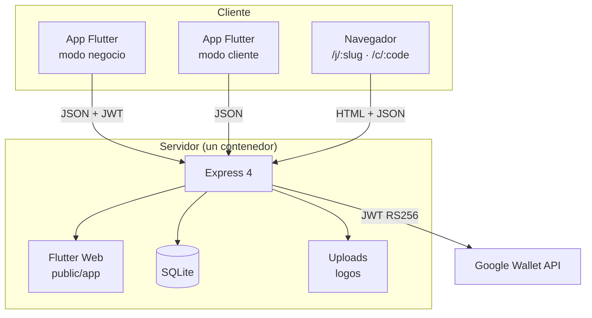
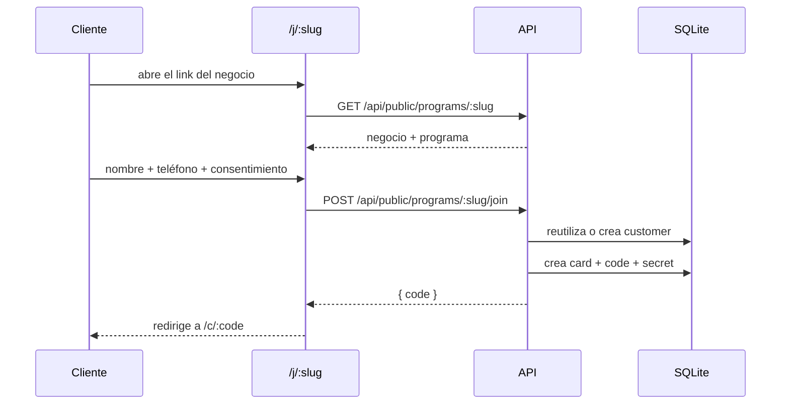
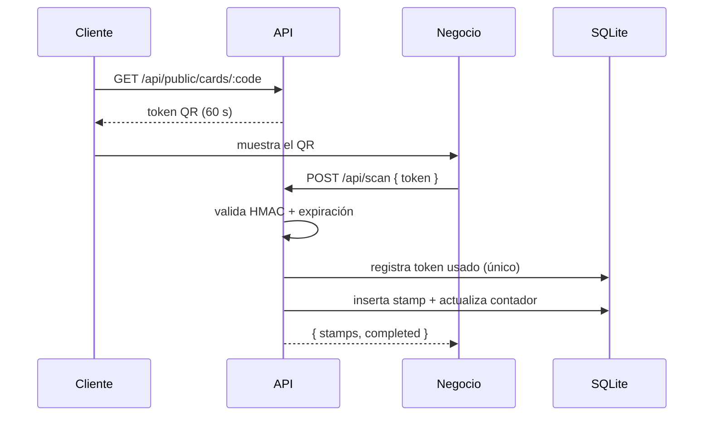

# Arquitectura

## Idea general

Sella es un monorepo con dos piezas y un solo despliegue:



En producción **un solo proceso** sirve:

| Ruta | Qué responde |
| --- | --- |
| `/api/*` | API REST |
| `/` y assets | Build de Flutter Web |
| `/j/:slug` | Página de inscripción (HTML server-side) |
| `/c/:code` | Tarjeta del cliente (HTML + QR) |
| `/wallet/mock/:code` | Pase de Wallet simulado |
| `/uploads/*` | Logos subidos por los negocios |

### Por qué un solo servicio

1. **Sin CORS**: la app y la API comparten origen.
2. **HTTPS gratis** en Render/Railway, requisito para `getUserMedia` (cámara) en web.
3. **Un link para compartir** en LinkedIn, no dos.
4. **Un `docker compose up`** levanta todo el producto.

El costo es que el build de Flutter viaja dentro de la imagen Docker (unos 35 MB de assets).
Es un intercambio razonable para una demo y perfectamente válido para un MVP real.

## Flujos principales

### Alta de un cliente



El código de tarjeta es aleatorio (6 caracteres base32) con prefijo del negocio.
El `secret` de 24 bytes se guarda por tarjeta y nunca sale del servidor.

### Sumar un sello



### Canje

El canje solo se permite si `cards.status = 'reward_ready'`. Reinicia el contador a 0,
vuelve a `active` y guarda una fila en `reward_redemptions` para auditoría y métricas.

## Seguridad del QR

Un QR estático es una tarjeta regalada: cualquiera lo fotografía y lo comparte.
Sella usa un token de un solo uso y vida corta.

```js
// backend/src/services/qr.js
const exp = Math.floor(Date.now() / 1000) + 60;
const nonce = crypto.randomBytes(4).toString('base64url');
const payload = `${cardId}.${exp}.${nonce}`;
const sig = hmacSha256(`${secret}:${PEPPER}`, payload);
return `S1.${base64url(payload)}.${sig}`;
```

Propiedades:

| Ataque | Defensa |
| --- | --- |
| Compartir una captura | El token expira en 60 s y se marca como usado. |
| Inventar un QR | La firma usa un secreto por tarjeta + `QR_PEPPER` del servidor. |
| Reusar el mismo QR | Tabla `qr_uses` con `token_hash` como clave primaria. |
| Doble tap del mozo | `idempotency_key` única en `stamps`. |
| Sellar 20 veces seguidas | `cooldown_minutes` y `max_per_day` por programa. |
| Sellar tarjetas ajenas | Cada consulta valida `programs.business_id = req.user.businessId`. |

El QR contiene un token opaco: no expone el teléfono ni el nombre del cliente.

## Decisiones y trade-offs

**SQLite en vez de Postgres.** Un archivo, cero configuración, ideal para demo y para negocios
chicos con pocas escrituras por minuto. Cuando haya varias instancias o escritura concurrente alta,
hay que migrar. El acceso está concentrado en `backend/src/db.js` y `services/repo.js`, así que el
cambio es acotado.

**JWT en vez de sesiones.** El cliente Flutter guarda el token en `shared_preferences`.
No hay revocación por sesión; para producción conviene refresh tokens y una tabla de sesiones.

**Un programa por negocio en la UI.** La base soporta varios (`programs` tiene `business_id`),
pero la app usa el primero. Es una decisión de producto para no abrumar en el onboarding.

**Estilo en JSON.** `programs.style_json` evita migraciones cada vez que se agrega una plantilla o
un ícono. El costo es que el backend no valida cada campo: normaliza y confía en el cliente
autenticado.

**Wallet desacoplado.** `services/google-wallet.js` detecta credenciales y, si no existen, devuelve
un mock. Así el flujo de producto se puede probar completo sin trámites y el día que lleguen las
credenciales no hay que tocar la app.

## Estructura del backend

```
src/
├── app.js              composición de middlewares y rutas (testeable)
├── index.js            arranque + seed automático
├── db.js               esquema, migraciones, rutas de datos
├── auth.js             JWT + bcrypt
├── seed.js             datos demo idempotentes
├── routes/
│   ├── auth.js         registro, login, /me
│   ├── business.js     perfil, logo, métricas
│   ├── programs.js     CRUD del programa
│   ├── cards.js        listado, alta manual, sello y canje
│   ├── public.js       inscripción y tarjeta pública
│   ├── scan.js         validación del QR
│   ├── wallet.js       link de Google Wallet
│   └── pages.js        /j, /c y /wallet/mock
└── services/
    ├── qr.js           firma y verificación
    ├── stamps.js       reglas de negocio de sellos
    ├── google-wallet.js clase, objeto y JWT RS256
    ├── html.js         plantillas server-side
    ├── repo.js         consultas compartidas
    └── util.js         slugs, códigos, serialización
```

## Estructura de la app

```
lib/
├── main.dart
├── models.dart                  modelos + serialización
├── core/
│   ├── api.dart                 cliente HTTP, errores, URLs
│   ├── session.dart             sesión del negocio
│   ├── customer_session.dart    sesión del cliente
│   ├── theme.dart               sistema de diseño
│   └── ui.dart                  componentes base
└── features/
    ├── landing_screen.dart
    ├── auth/                    login y registro
    ├── business/                shell, dashboard, editor, scanner, clientes
    ├── customer/                entrada y tarjeta
    └── shared/                  LoyaltyCardView + StampGrid
```

`LoyaltyCardView` es el mismo widget en la vista previa del editor, en el dashboard y en la
tarjeta del cliente. Una sola fuente de verdad para el diseño.

## Qué cambiaría para producción

1. Postgres + migraciones (Drizzle, Knex o Prisma).
2. Rate limiting (`express-rate-limit`) y captcha en la inscripción pública.
3. Refresh tokens y revocación.
4. Cola de trabajos para notificaciones (WhatsApp/email).
5. Observabilidad: logs estructurados, Sentry, métricas de canje.
6. Backups del volumen `/data` y prueba de restauración.
