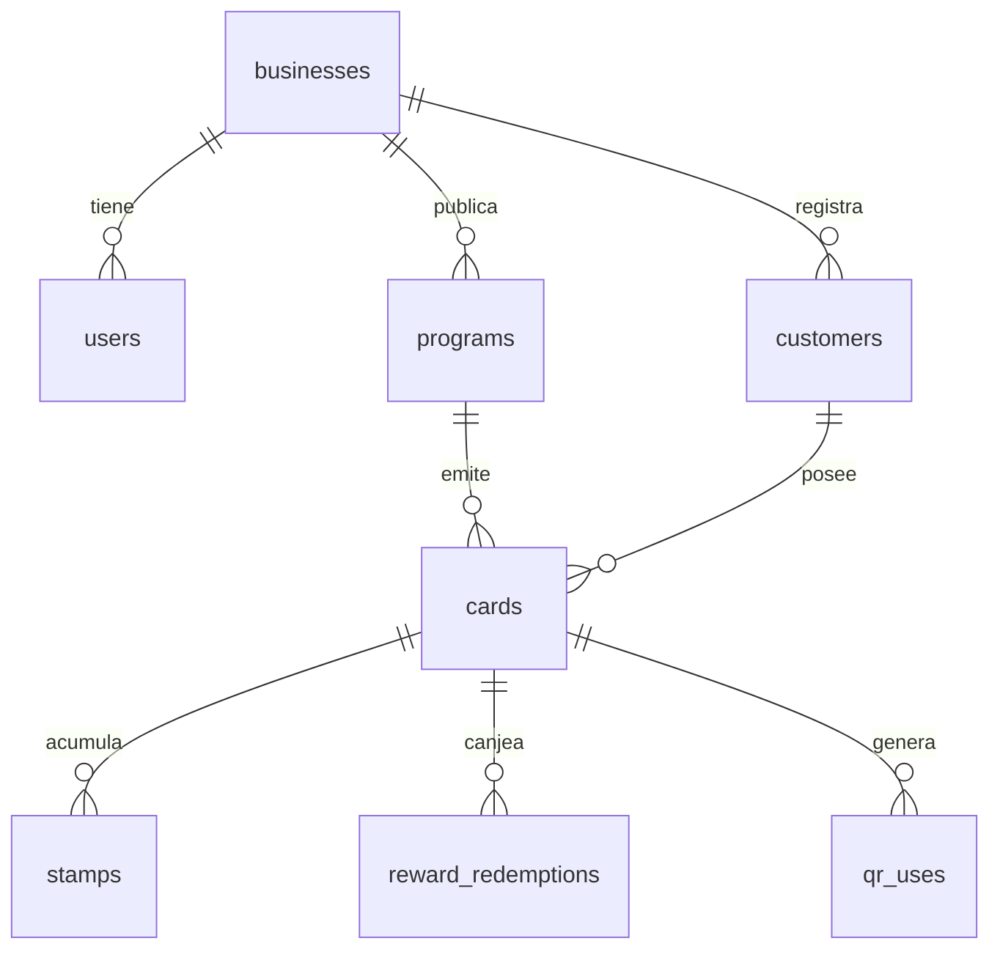

# Modelo de datos

SQLite con `journal_mode = WAL` y claves foráneas activas. El esquema se crea al arrancar
(`CREATE TABLE IF NOT EXISTS`) en `backend/src/db.js`.



## Tablas

### `businesses`

| Columna | Tipo | Notas |
| --- | --- | --- |
| `id` | TEXT PK | UUID v4 |
| `name` | TEXT | Nombre público |
| `slug` | TEXT UNIQUE | Se deriva del nombre, se desambigua con `-2`, `-3`… |
| `logo_url` | TEXT | Ruta relativa `/uploads/...` |
| `brand_color` | TEXT | Hex `#RRGGBB` |
| `created_at` | TEXT | ISO 8601 |

### `users`

| Columna | Tipo | Notas |
| --- | --- | --- |
| `id` | TEXT PK | |
| `business_id` | TEXT FK | `ON DELETE CASCADE` |
| `email` | TEXT UNIQUE | Siempre en minúsculas |
| `password_hash` | TEXT | bcrypt, 10 rondas |
| `name` | TEXT | |
| `role` | TEXT | `owner` hoy; `staff` está previsto |
| `created_at` | TEXT | |

### `programs`

| Columna | Tipo | Notas |
| --- | --- | --- |
| `id` | TEXT PK | |
| `business_id` | TEXT FK | |
| `name` | TEXT | "Club Aurora" |
| `description` | TEXT NULL | |
| `reward_text` | TEXT | "Un flat white gratis" |
| `stamps_required` | INTEGER | 2 a 30 (la UI limita a 20) |
| `cooldown_minutes` | INTEGER | 0 = sin límite |
| `max_per_day` | INTEGER | 0 = sin límite |
| `style_json` | TEXT | JSON con el diseño de la tarjeta |
| `active` | INTEGER | 0/1 |
| `created_at` | TEXT | |

`style_json` normalizado:

```json
{
  "template": "ticket",
  "background": "#A24B2A",
  "foreground": "#FFF7ED",
  "accent": "#F2C14E",
  "stampIcon": "coffee",
  "pattern": "dots",
  "cornerRadius": 26,
  "showLogo": true
}
```

### `customers`

| Columna | Tipo | Notas |
| --- | --- | --- |
| `id` | TEXT PK | |
| `business_id` | TEXT FK | El cliente pertenece a un negocio |
| `name` | TEXT | |
| `phone` | TEXT NULL | Único por negocio (índice parcial) |
| `email` | TEXT NULL | |
| `consent_at` | TEXT | Marca de tiempo del consentimiento |
| `created_at` | TEXT | |

El índice `idx_customers_phone` es parcial:

```sql
CREATE UNIQUE INDEX idx_customers_phone
ON customers(business_id, phone)
WHERE phone IS NOT NULL AND phone <> '';
```

Un mismo teléfono puede estar en dos negocios distintos, pero no dos veces en el mismo.

### `cards`

| Columna | Tipo | Notas |
| --- | --- | --- |
| `id` | TEXT PK | |
| `program_id` | TEXT FK | |
| `customer_id` | TEXT FK | |
| `code` | TEXT UNIQUE | `CAFE-8F3K` |
| `stamps` | INTEGER | Contador actual |
| `status` | TEXT | `active` / `reward_ready` |
| `secret` | TEXT | 24 bytes base64url, nunca sale del server |
| `created_at` / `updated_at` | TEXT | |

No hay índice único en `(program_id, customer_id)` porque la aplicación ya evita duplicados,
pero conviene agregarlo si se importan datos de otro sistema.

### `stamps`

| Columna | Tipo | Notas |
| --- | --- | --- |
| `id` | TEXT PK | |
| `card_id` | TEXT FK | |
| `staff_id` | TEXT FK NULL | Quién lo otorgó |
| `source` | TEXT | `scan` / `manual` |
| `idempotency_key` | TEXT UNIQUE | Evita doble sello |
| `created_at` | TEXT | |

### `reward_redemptions`

| Columna | Tipo | Notas |
| --- | --- | --- |
| `id` | TEXT PK | |
| `card_id` | TEXT FK | |
| `staff_id` | TEXT FK NULL | |
| `reward_text` | TEXT | Copia histórica de la recompensa |
| `idempotency_key` | TEXT UNIQUE | |
| `redeemed_at` | TEXT | |

### `qr_uses`

| Columna | Tipo | Notas |
| --- | --- | --- |
| `token_hash` | TEXT PK | SHA-256 del token completo |
| `card_id` | TEXT | Sin FK: se limpia solo |
| `used_at` | TEXT | Se purgan los mayores a 10 minutos |

## Invariantes

1. `cards.stamps` nunca supera `programs.stamps_required`.
2. Si `cards.stamps = stamps_required`, entonces `cards.status = 'reward_ready'`.
3. Un sello y su fila en `stamps` se escriben en la misma transacción.
4. El canje reinicia `stamps` a 0 en la misma transacción que inserta la redención.
5. Un token de QR se acepta una sola vez, incluso dentro de los 60 segundos de validez.

## Consultas útiles

Clientes de un negocio con su progreso:

```sql
SELECT c.code, cu.name, cu.phone, c.stamps, p.stamps_required, c.status
FROM cards c
JOIN customers cu ON cu.id = c.customer_id
JOIN programs p ON p.id = c.program_id
WHERE p.business_id = ?
ORDER BY c.updated_at DESC;
```

Sellos de hoy:

```sql
SELECT COUNT(*) AS total
FROM stamps s
JOIN cards c ON c.id = s.card_id
JOIN programs p ON p.id = c.program_id
WHERE p.business_id = ? AND s.created_at >= ?;
```

## Migraciones

Hoy el esquema es idempotente y se aplica en cada arranque. Cuando cambie una columna existente,
hace falta un sistema de migraciones (por ejemplo `better-sqlite3` + una tabla `schema_version`).
El punto de entrada está aislado en `migrate()` para que el cambio no toque las rutas.
